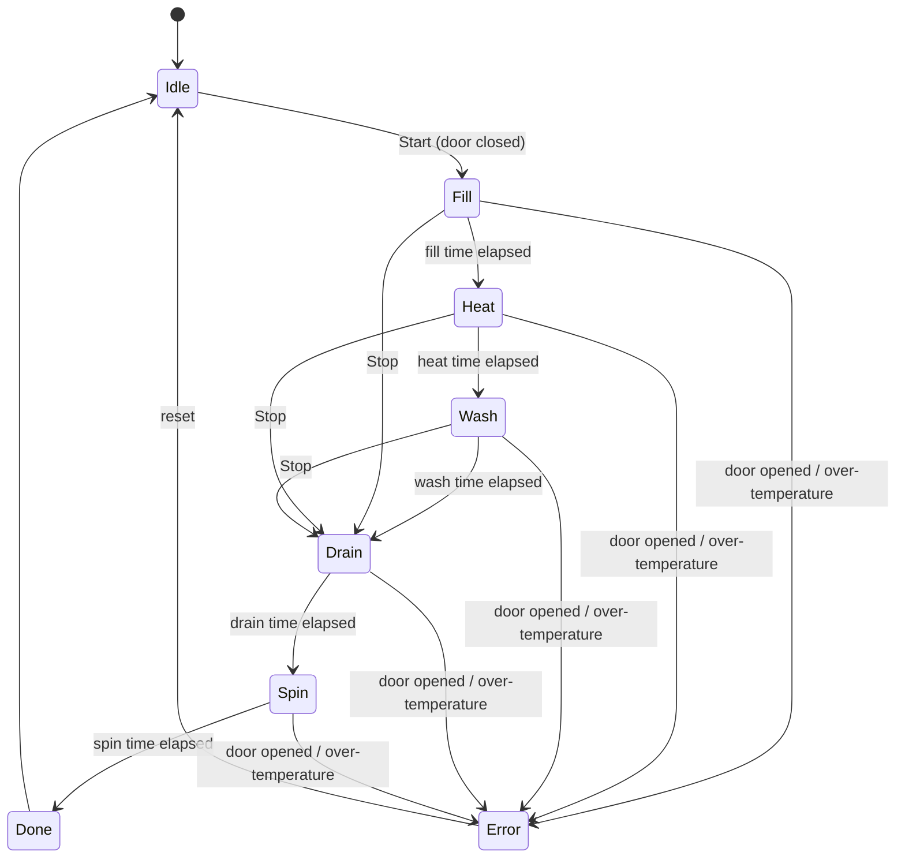

# Mini Appliance Firmware

A simplified washing-machine controller running on two very different microcontrollers: an **ESP32 with FreeRTOS** and an **Infineon XMC1100 (XMC 2Go) running bare-metal**. The same application logic runs on both platforms behind a hardware abstraction layer.

The project is built the way appliance software is built in industry: **requirements first**, every requirement traced to automated tests, unit tests running on the PC, hardware test cases on the real boards, and a CI pipeline on every push.

> **Status:** work in progress. See [Roadmap](#roadmap).

---

## Goals

1. **Microcontroller fundamentals:** GPIO, interrupts, hardware timers, ADC, UART and a watchdog, on real hardware.
2. **Professional engineering practice:** requirements → implementation → tests, with full traceability between them.
3. **Portable design:** application logic independent of the hardware, proven by running it on two platforms (RTOS and bare-metal).
4. **Testability:** program logic unit-tested on the PC with fake hardware, so most behaviour is verified without a board.
5. **Automation:** CI that builds the firmware and runs the tests on every push, plus a Python tool for automated hardware tests.

---

## What it does

The controller runs a washing program through these phases:



On the test bench, LEDs stand in for the motor, heater and water valve, buttons for start, stop and the door, and a potentiometer for the water temperature.

---

## Architecture

```
┌─────────────────────────────────────────────┐
│ Application logic (portable C++)            │
│   state machine · temperature control ·     │
│   command parser · debounce                 │
├─────────────────────────────────────────────┤
│ Hardware interfaces                         │
│   IHeater · IMotor · IValve · ITemperature  │
│   IDoor · IClock · ISerial                  │
├───────────────┬───────────────┬─────────────┤
│ ESP32         │ XMC1100       │ Fakes       │
│ (ESP-IDF,     │ (XMCLib,      │ (PC unit    │
│  FreeRTOS)    │  bare-metal)  │  tests)     │
└───────────────┴───────────────┴─────────────┘
```

- The **application layer** never calls hardware directly. It only uses the interfaces.
- Each **platform** provides its own implementation of the interfaces.
- The **fake implementations** let the full program logic run and be tested on a PC.

| | ESP32 | XMC1100 (XMC 2Go) |
|---|---|---|
| Core | Xtensa dual-core | ARM Cortex-M0, 32 MHz |
| Memory | 520 KB SRAM | 16 KB RAM, 64 KB flash |
| Execution model | FreeRTOS tasks | Bare-metal, timer-driven main loop |
| Framework | ESP-IDF | XMC Peripheral Library (XMCLib) |
| Debugging | Serial logging | On-board J-Link (breakpoints, stepping) |

---

## Requirements

| ID | Requirement |
|---|---|
| REQ-01 | Start begins the selected program only if the door is closed and the machine is idle. |
| REQ-02 | Phases run in order: fill → heat → wash → drain → spin → done, each with a configured duration. |
| REQ-03 | The heater may be on only during the heat phase. |
| REQ-04 | During heat, the heater turns off at the target temperature and back on 3 °C below it. |
| REQ-05 | Above the maximum temperature, all outputs turn off and the machine enters an error state with the error LED lit. |
| REQ-06 | Opening the door during a cycle turns all outputs off within 100 ms and enters an error state. |
| REQ-07 | Stop turns motor and heater off within 100 ms and goes to drain, then idle. |
| REQ-08 | Every state change is reported over UART. |
| REQ-09 | The PC can send `START`, `STOP`, `STATUS` and `SET_PROG` commands over UART. |
| REQ-10 | Invalid commands get an error response and change nothing. |
| REQ-11 | Button presses shorter than 50 ms are ignored. |
| REQ-12 | If the main task stalls for more than 2 s, a watchdog resets the device into a safe idle state. |

---

## Testing

Testing happens at three levels, and every test names the requirement it verifies.

| Level | Where it runs | What it covers |
|---|---|---|
| Unit tests | PC (GoogleTest, PlatformIO `native` environment) | State machine, temperature control, command parser, debounce |
| Automated hardware tests | Real board, driven by a Python script over UART | Commands, error responses, state reporting |
| Manual hardware test cases | Real board, test bench | Timing, buttons, door, temperature, watchdog |

**Traceability example:** `REQ-04` → unit test `REQ04_HeaterOffAtTarget` → hardware test case `TC-03`.

| Test case | Requirement(s) | Expected result |
|---|---|---|
| TC-01 | REQ-01 | Door open + start → nothing happens, UART reports "door open" |
| TC-02 | REQ-01, REQ-02 | Door closed + start → all phases run in order |
| TC-03 | REQ-03, REQ-04 | Heater LED off at target, on again 3 °C below |
| TC-04 | REQ-05 | Over-temperature → all outputs off, error LED on |
| TC-05 | REQ-06 | Door opened during wash → outputs off within 100 ms |
| TC-06 | REQ-07 | Stop during heat → heater and motor off, drain, idle |
| TC-07 | REQ-08 | Every state change in a full cycle reported over UART |
| TC-08 | REQ-09 | `START`, `STOP`, `STATUS`, `SET_PROG` behave as specified |
| TC-09 | REQ-10 | Garbage, empty and over-long commands → error, state unchanged |
| TC-10 | REQ-11 | Very short tap ignored, normal press accepted |
| TC-11 | REQ-12 | Blocked main task → watchdog reset within 2 s into idle |
| TC-12 | Regression | 10 full cycles in a row without error |

---

## Repository structure

```
.
├── app/                 # Portable application logic (no hardware calls)
├── hal/                 # Hardware interfaces
├── platform/
│   ├── esp32/           # ESP-IDF / FreeRTOS implementation
│   └── xmc1100/         # XMCLib bare-metal implementation
├── test/
│   ├── unit/            # PC unit tests with fake hardware
│   └── hardware/        # Python hardware test scripts
├── tools/               # Python serial tool
├── docs/
│   └── REQUIREMENTS.md
└── .github/workflows/   # CI pipeline
```

---

## Getting started

### ESP32

Requires [VS Code](https://code.visualstudio.com/) with the [PlatformIO](https://platformio.org/) extension.

```bash
pio run -e esp32 -t upload     # build and flash
pio device monitor             # open the serial monitor
```

### XMC1100 (XMC 2Go)

Requires Infineon ModusToolbox and the SEGGER J-Link software.

```bash
make build                     # build
make program                   # flash through the on-board J-Link
make vscode                    # generate VS Code build and debug configuration
```

### Unit tests on the PC

```bash
pio test -e native
```

---

## UART commands

| Command | Response |
|---|---|
| `START` | Starts the selected program (if allowed by REQ-01) |
| `STOP` | Safe stop: drain, then idle |
| `STATUS` | Current state, phase time remaining, temperature |
| `SET_PROG <n>` | Selects program `n` (only while idle) |

Any other input returns `ERR <reason>` and changes nothing.

---

## Roadmap

- [ ] ESP32 basics: GPIO, interrupts, timer, ADC, UART
- [ ] Requirements documented
- [ ] Hardware interfaces and portable state machine
- [ ] Unit tests on the PC for every requirement
- [ ] Hardware test cases TC-01 to TC-12 on the ESP32
- [ ] CI: firmware build and unit tests on every push
- [ ] Python tool for automated hardware tests
- [ ] XMC1100 bare-metal port
- [ ] Hardware test cases TC-01 to TC-12 on the XMC1100
- [ ] Register-level GPIO example on the ATmega328P

---

## License

MIT
